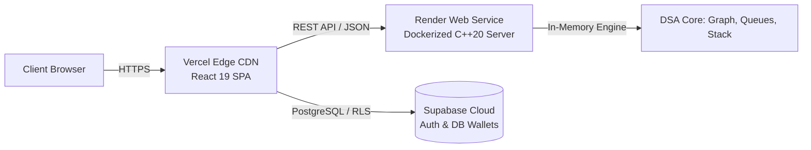

# 🚀 Deployment Architecture & Changes

This document details all structural, architectural, and code modifications implemented to deploy the Forex Currency Exchange platform across **Render** (C++20 Docker Engine) and **Vercel** (React 19 + Vite Dashboard).

---

## 🏗️ High-Level Deployment Architecture



---

## 1. 🐳 Docker Configuration (`Dockerfile` & `.dockerignore`)

### A. Multi-Stage Dockerfile (`/Dockerfile`)
The C++ backend was containerized using a two-stage build to minimize image size and eliminate host environment discrepancies:

- **Stage 1 (Builder - `gcc:13`):**
  - Copies header dependencies (`include/`, `src/`) and `server.cpp`.
  - Compiles with C++20 (`-std=c++20`), `-O2` optimizations, and POSIX threads (`-pthread`).
  - **Crucial Linker Flags (`-static-libgcc -static-libstdc++`)**: Prevents runtime dynamic linker crashes (`libstdc++.so.6 not found`) when the compiled binary is copied to a minimal Debian environment.

- **Stage 2 (Runner - `debian:bookworm-slim`):**
  - Keeps the final production container minimal (~80MB vs >1.2GB builder image).
  - Installs runtime dependencies: `ca-certificates` and `libstdc++6`.
  - Grants executable permissions: `chmod +x /app/forex_server`.
  - Listens on `EXPOSE 8080`.

```dockerfile
# Stage 1: Build binary
FROM gcc:13 AS builder
WORKDIR /app
COPY include/ ./include/
COPY src/ ./src/
COPY server.cpp ./
RUN g++ -std=c++20 -O2 -pthread -static-libgcc -static-libstdc++ -Iinclude -Isrc server.cpp -o forex_server

# Stage 2: Minimal runner
FROM debian:bookworm-slim
WORKDIR /app
RUN apt-get update && apt-get install -y ca-certificates libstdc++6 && rm -rf /var/lib/apt/lists/*
COPY --from=builder /app/forex_server /app/forex_server
RUN chmod +x /app/forex_server
EXPOSE 8080
CMD ["/app/forex_server"]
```

### B. Build Context Optimization (`/.dockerignore`)
Added `/.dockerignore` to avoid uploading unnecessary local binaries and node packages to Render:
- Excludes: `node_modules/`, `frontend/dist/`, `*.exe`, `*.o`, `.git/`, and IDE cache files.

---

## 2. ⚡ C++ Backend Engine Modifications (`server.cpp`)

### A. Dynamic Port Allocation (`$PORT`)
Render dynamically assigns a random port to web services via the `PORT` environment variable. The server was modified to inspect the environment before falling back to `8080`:

```cpp
// server.cpp: Dynamic cloud port reading
const char* env_port = std::getenv("PORT");
int port = env_port ? std::atoi(env_port) : 8080;
```

### B. Unbuffered Real-time Logging (`std::unitbuf`)
By default, standard output streams are block-buffered in Docker containers, delaying log visibility in cloud dashboards. Added immediate buffer flushing:

```cpp
// server.cpp: Flush stdout immediately to Render logs
std::cout << std::unitbuf;
```

---

## 3. 🌐 Frontend & Vercel Modifications

### A. Dynamic Environment Variable API Client (`frontend/src/api.js`)
Decoupled local hardcoded URLs (`http://localhost:8080`) to support Vite environment variables with automatic trailing-slash normalization:

```javascript
// frontend/src/api.js
const API_BASE = (import.meta.env.VITE_API_URL || 'http://localhost:8080').replace(/\/+$/, '') + '/api';
```

### B. Single-Page Application (SPA) Routing (`frontend/vercel.json`)
Created `frontend/vercel.json` to configure URL rewrites so sub-routes and deep links do not return `404 Not Found` on Vercel:

```json
{
  "rewrites": [
    {
      "source": "/(.*)",
      "destination": "/"
    }
  ]
}
```

### C. Environment Variable Blueprint (`frontend/.env.example`)
Created `.env.example` to document all keys required in Vercel project settings:
```ini
VITE_SUPABASE_URL=https://<your-project>.supabase.co
VITE_SUPABASE_ANON_KEY=<your-anon-key>
VITE_SUPABASE_PUBLISHABLE_KEY=<your-anon-key>
VITE_API_URL=https://<your-render-service>.onrender.com
```

---

## 4. 🔒 Security & Git Hygiene (`.gitignore`)

Updated `/.gitignore` to prevent sensitive credentials and local environment files from being exposed to public repositories:
- Added `.env`, `.env.*`, `frontend/.env`, and `frontend/.env.local`.
- In production, environment variables are managed securely through the **Vercel** and **Render** dashboards.

---

## 5. 📋 Summary of Files Added / Modified

| File | Type | Purpose |
| :--- | :--- | :--- |
| `Dockerfile` | **Created** | Multi-stage C++20 compiler and runtime container for Render |
| `.dockerignore` | **Created** | Speeds up Docker builds by excluding local build artifacts |
| `server.cpp` | **Modified** | Dynamic `$PORT` handling and unbuffered output stream |
| `frontend/vercel.json` | **Created** | SPA rewrite rules for client routing on Vercel |
| `frontend/src/api.js` | **Modified** | `VITE_API_URL` dynamic base URL injection with trailing slash sanitization |
| `frontend/.env.example`| **Created** | Documentation template for production environment variables |
| `.gitignore` | **Modified** | Ignore `.env` files and local binaries from version control |
